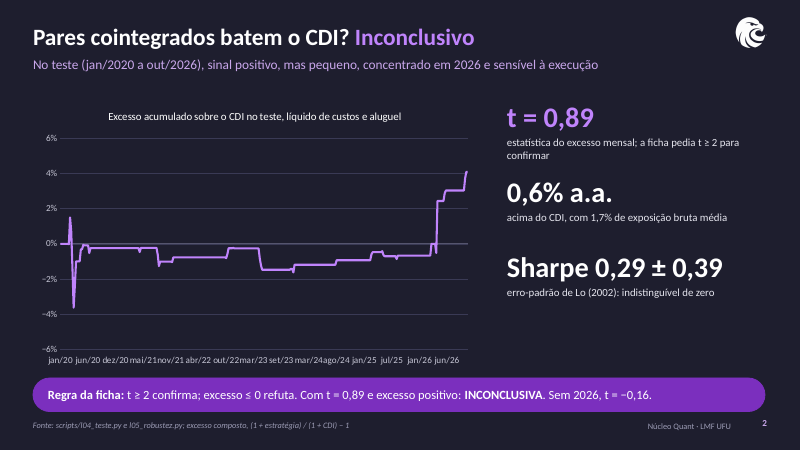
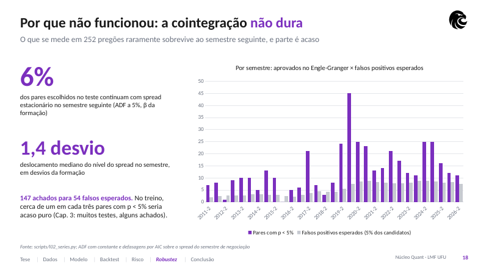
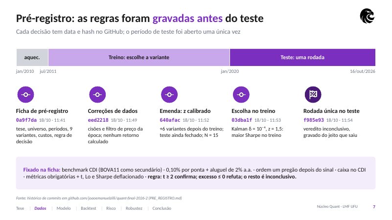

# Pares cointegrados na B3

Projeto final do **Núcleo de Análise Quantitativa** da Liga de Mercado
Financeiro da UFU (LMF UFU), ciclo 2026.2. Arbitragem estatística com
pares de ações, filtro de Kalman, pré-registro e um único teste fora da
amostra, seguindo o protocolo do Capítulo 12 do livro do Núcleo
(*Finanças quantitativas com Python*).

**Integrantes:** _a preencher pelo grupo (nomes e cursos)_.



## Tese

Entre ações da B3 do mesmo setor, os pares cujos log-preços se mostram
cointegrados nos 252 pregões anteriores têm um spread que volta à média
no semestre seguinte. Uma carteira comprada e vendida de soma zero, que
abre posição quando o spread se afasta da média e fecha quando ele volta,
rende acima do CDI, líquida de custos de transação e de aluguel de ações.

O mecanismo é a lei do preço único com limites à arbitragem: choques de
liquidez sem informação afastam ações ligadas (ON e PN da mesma empresa,
holding e controlada, concorrentes), e o custo e o risco da venda a
descoberto impedem que o desvio seja eliminado na hora.

## Resultado

**Inconclusivo**, pela regra escrita antes do teste (t ≥ 2 confirma;
excesso médio ≤ 0 refuta).

| Teste (jan/2020 a 16/out/2026) | Estratégia | CDI | BOVA11 |
|---|---|---|---|
| Retorno a.a. | 10,9% | 10,2% | 8,9% |
| Excesso a.a. sobre o CDI | 0,60% | – | −1,21% |
| Volatilidade a.a. | 2,2% | 0,3% | 24,2% |
| Sharpe (erro-padrão de Lo) | 0,29 (0,39) | – | 0,07 |
| Drawdown máximo | −6,6% | 0,0% | −46,9% |
| Operações / taxa de acerto | 39 / 64% | – | – |
| Beta diário ao Ibovespa | 0,02 | – | – |
| t do excesso mensal | **0,89** (p = 0,37) | – | – |

- **Significância econômica pequena:** a exposição bruta média foi de
  1,7% do patrimônio, e o excesso desaparece com custo de 0,50% por ponta
  ou com execução fora do pregão seguinte ao sinal.
- **Concentração:** de 2020 a 2025 o t do excesso é −0,16. O resultado
  positivo vem de 2026, e uma única operação (AMER3/MGLU3) rendeu 2,4% do
  patrimônio, para 4,1% de excesso no teste todo.
- **A seleção ajuda, a regra não basta:** a estratégia fica no percentil
  98 de 200 carteiras de pares sorteados no mesmo setor, mas a regra de
  negociação aplicada a pares sorteados perde do CDI (Sharpe mediano −0,15).
- **Por que não funcionou:** só 6% dos pares cointegrados na formação
  continuam com spread estacionário no semestre seguinte, quase a taxa de
  falso positivo do teste. No treino, 147 pares passaram a 5% para 54
  falsos positivos esperados.



## Pré-registro e trilha de auditoria

A ficha [`PRE_REGISTRO.md`](PRE_REGISTRO.md) foi gravada antes de qualquer
backtest. Cada decisão está em um commit datado:

| Commit | O que fixou |
|---|---|
| `0a9f7da` | ficha: tese, universo, períodos, 9 variantes, custos, regra de decisão |
| `eed2218` | correções de dados (cisões não ajustadas pelo Yahoo) e filtro de preço da época, sem nenhum retorno calculado |
| `640afac` | emenda depois do treino da grade original, com o teste ainda fechado: 6 variantes com z-score calibrado; N = 15 |
| `03dba1f` | escolha no treino: Kalman δ = 10⁻⁴, z = 1,5 (Sharpe 0,444 contra 0,440 da segunda) |
| `f985e93` | rodada única no teste, gravada como saiu |



## Como rodar

Python 3.12. De dentro da raiz do repositório:

```bash
python -m venv .venv
source .venv/bin/activate          # no Windows: .venv\Scripts\activate
pip install -r requirements.txt
bash scripts/rodar_tudo.sh         # l01 a l07, testes e apresentação (cerca de 2 minutos)
```

Ou script a script, na ordem dos números:

| Script | O que faz |
|---|---|
| `scripts/baixar_dados.py` | rodou uma vez, em 18/10/2026; grava `dados/bruto/` (não precisa rodar de novo) |
| `scripts/l01_dados.py` | faltantes, retornos extremos e conferência do Yahoo contra o fechamento oficial da B3 |
| `scripts/l02_series.py` | ADF e KPSS do par-exemplo, persistência da cointegração, múltiplos testes |
| `scripts/l03_treino.py` | grade de 15 variantes no treino (jul/2011 a dez/2019) e escolha |
| `scripts/l04_teste.py` | rodada única no teste, métricas obrigatórias e veredito |
| `scripts/l05_robustez.py` | custos, aluguel, atraso, setores, grade no teste, por ano, pares sorteados |
| `scripts/l06_risco.py` | VaR e CVaR (4 métodos), Kupiec, GARCH(1,1) t, estresse, drawdown |
| `scripts/l07_slides.py` | exporta todos os números e séries para `slides/dados.json` |
| `python -m pytest tests` | 14 testes de sanidade (simulador, Kalman, meia-vida, look-ahead, dados) |

A apresentação é gerada a partir de `slides/dados.json`, sem nenhum
número digitado à mão:

```bash
cd slides && npm install && node build_deck.js   # Node 18 ou mais novo
```

## Estrutura

```
PRE_REGISTRO.md          ficha de pré-registro, mudanças e emenda
dados/bruto/             dados congelados (Yahoo, CDI, desdobramentos, conferência B3)
dados/correcoes.csv      eventos que o Yahoo não ajusta, com a fonte de cada linha
pares/                   código: config, dados, séries, Kalman, seleção, motor, métricas
scripts/                 l01 a l07, na ordem de execução
tests/                   testes de sanidade
resultados/              tabelas e JSONs que os slides leem
slides/                  gerador da apresentação, .pptx e .pdf
```

## Metodologia em uma página

- **Dados:** 73 ações em 15 setores, fechamentos ajustados por proventos
  do Yahoo Finance (jan/2010 a 16/out/2026), conferidos contra o fechamento
  oficial da B3 (correlação dos retornos diários ≥ 0,97); CDI da série 12
  do SGS/BCB (cópia congelada do livro do Núcleo até 2025; 2026 pela Selic
  over do Ipeadata menos 0,10 p.p., a mesma diferença de todos os dias de
  2019 a 2025).
- **Formação** (252 pregões antes de cada semestre): liquidez ≥ R$ 10
  mi/dia e preço da época ≥ R$ 5; Engle-Granger nas duas ordens, p < 5%;
  meia-vida AR(1) entre 2 e 63 pregões; até 10 pares, no máximo 2 por ação
  e 3 por setor.
- **Sinal:** filtro de Kalman para β e α; z = erro de previsão ÷ desvio
  previsto; entra com |z| ≥ 1,5, sai quando z cruza zero, stop em |z| ≥
  3,5; posições fechadas no fim do semestre.
- **Carteira:** ordem no fechamento do pregão seguinte ao sinal; 20% de
  exposição bruta por par, pernas na proporção 1 : β; caixa (inclusive o
  produto da venda a descoberto) a 100% do CDI; 0,10% por ponta e aluguel
  de 2% a.a. sobre a ponta vendida; retornos brutos de IR.
- **Avaliação:** Sharpe sobre o excesso diário ao CDI (252 pregões), erro-
  padrão de Lo (2002), Sharpe deflacionado (Bailey e López de Prado), t do
  excesso mensal, beta com erro-padrão HAC.

## Limitações e próximos passos

Universo escolhido hoje (viés de sobrevivência); dados gratuitos com
cinco correções manuais; custo por ponta único, sem impacto de mercado;
15 variantes, e a escolhida venceu a segunda por 0,004 de Sharpe. O
próximo passo natural é um teste prospectivo, com a regra congelada a
partir de novembro de 2026, sobre um universo com a composição histórica
do Ibovespa e dados COTAHIST, e com uma seleção que exija estabilidade do
spread fora da amostra (walk-forward).

## Referências

- Bailey, D. e López de Prado, M. (2014). The deflated Sharpe ratio. *Journal of Portfolio Management*, 40(5).
- Caldeira, J. e Moura, G. (2013). Selection of a portfolio of pairs based on cointegration. *Revista Brasileira de Finanças*, 11(1).
- Chan, E. (2013). *Algorithmic Trading*. Wiley.
- Do, B. e Faff, R. (2010). Does simple pairs trading still work? *Financial Analysts Journal*, 66(4).
- Gatev, E., Goetzmann, W. e Rouwenhorst, K. G. (2006). Pairs trading. *Review of Financial Studies*, 19(3).
- Lo, A. (2002). The statistics of Sharpe ratios. *Financial Analysts Journal*, 58(4).
- Zilli dos Santos, J. E. (2026). *Finanças quantitativas com Python*. Núcleo de Análise Quantitativa, LMF UFU.

*Material com finalidade educacional. Nada aqui é recomendação de investimento.*
